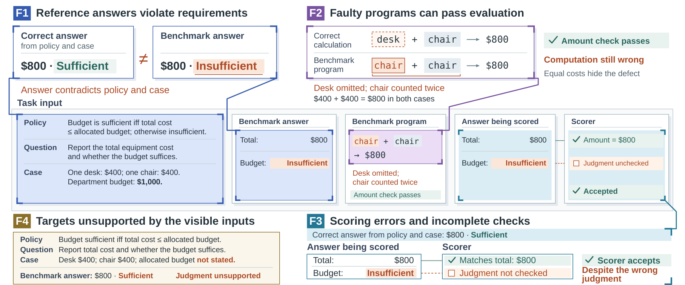

# BAR — Benchmark Audit and Revision

Resources for **Follow the Policy, Fail the Benchmark: Auditing and Revising
Policy-Based Decision Benchmarks**, by Yanru Xiao and Yifei Cai.

Policy-based decision benchmarks ask a model to apply a written policy to a
case, but the policy, the case, the reference answer, any supplied intermediate
answers and the scoring rule do not always describe the same decision. When
they disagree, a policy-supported response can be rejected and an incomplete
one accepted.

Rescoring unchanged model responses shows how these defects change scores.
In RuleArena Tax, restoring the required zero floor changes 27 of 300
reference amounts and narrows one observed model gap from 14 to 4
accepted cases. In LegalBench's SARA numeric task, correcting decimal parsing
and zero-reference scoring raises accepted answers from 8–9 to 87–91 out of
96 across three models, with reference answers unchanged. The
[full results](docs/REPRODUCING.md#expected-results) give the per-model
comparisons.

BAR publishes the audit evidence behind these findings, along with scoped
revisions for reevaluating models.

**[Paper — arXiv:2611.07042](https://arxiv.org/abs/2611.07042)**
· [Download v0.3.0](https://github.com/SugarRuy/BAR-Policy-Decision/releases/tag/v0.3.0)
· [Usage and setup](docs/COMPONENTS.md)
· [Python API](docs/API.md)
· [Audit evidence](evidence/README.md)
· [Reproduce the studies](docs/REPRODUCING.md)



*Figure 1 from the paper. Independent variants of a hypothetical
equipment-budget task illustrate the four classes of findings.*

## Revised resources

BAR provides seven revision components across the five tasks below. Airline
has three separate components. Each revision targets a specific reference,
scorer or task text; usage and scope are in the
[component guide](docs/COMPONENTS.md).

| Benchmark / task | What BAR provides |
|---|---|
| RuleArena Tax | 300 original/T1/T1+T2 references, unchanged native inputs and a reference-program patch; the latest revision changes 21 amounts beyond T1 |
| LegalBench SARA numeric | A revised numeric scorer; original labels unchanged |
| ConditionalQA | A revised scorer that counts missing predictions as zero instead of dropping them; original labels unchanged |
| RuleArena Airline | Separate revisions for policy transcription and examples, amount scoring, and an explicit minimum-cost objective that amends the task specification |
| RuleArena NBA | Corrections to two team/operation localization fields among 216 records; all binary verdicts unchanged |

Tax `v0.3.0` additionally removes a calculator branch absent from the supplied
policy. It differs from the original key in 43 cases; the paper's T1-only
revision changed 27. The [revision record](components/rulearena-tax/revisions/t1-t2-1/README.md)
explains the negative values produced by the supplied formulas and the remaining
zero-default convention. The paper and its model results are unchanged.

## Python API

The `bar_policy` package loads the integrated revised Tax and Airline datasets
from your local pinned RuleArena checkout, keeping model-visible messages
separate from references and provenance, and exposes the BAR and native
scorers. Nothing is downloaded.

```bash
python3 -m pip install .
```

```python
import bar_policy as bar

airline = bar.load_dataset("rulearena-airline", "/data/RuleArena")
example = airline[0]
example.messages                          # send only these to a model
example.score("The total cost is $1,245.")
```

See the [API guide](docs/API.md) for datasets, scoring, versions and errors.
The API also checks ConditionalQA prediction IDs and answer structure, and
defaults to complete numeric parsing for Tax. An explicit native Tax mode
with `release="0.2.0"` preserves reproduction of the paper's scores; see the
[change log](CHANGELOG.md).

## Audit evidence

The [evidence index](evidence/README.md) covers nine audit entries, including
controls and unresolved findings: RuleArena, OpenExempt, LegalBench SARA,
DeonticBench, ConditionalQA, ShARC, PolicyGuardBench, WorkArena++ and
TheAgentCompany. Findings differ across entries. Where no revision is listed
above, including the workflow environments, the entry is documented as audit
evidence.

## Reproducing the studies

Four saved-response studies cover RuleArena Tax, LegalBench SARA numeric,
ConditionalQA and an amended OpenExempt task with supplied intermediate
answers. The reported results can be rescored from the saved outputs in the
v0.2.0 release by following the [reproduction guide](docs/REPRODUCING.md).
Some upstream inputs are obtained separately under their original terms. The
Airline and NBA revisions come without new performance results.

## Citation and license

Please cite [the paper](https://arxiv.org/abs/2611.07042) and the original
benchmarks you use, and report which BAR revisions and source versions your
results are based on. GitHub's citation menu uses [CITATION.cff](CITATION.cff).

```bibtex
@misc{xiao2026followpolicy,
  title         = {Follow the Policy, Fail the Benchmark: Auditing and Revising Policy-Based Decision Benchmarks},
  author        = {Xiao, Yanru and Cai, Yifei},
  year          = {2026},
  eprint        = {2611.07042},
  archivePrefix = {arXiv},
  primaryClass  = {cs.CL},
  url           = {https://arxiv.org/abs/2611.07042}
}
```

BAR-original code is released under the
[MIT License](LICENSE). Third-party code and data keep their own terms, listed
in [THIRD_PARTY.md](THIRD_PARTY.md).
